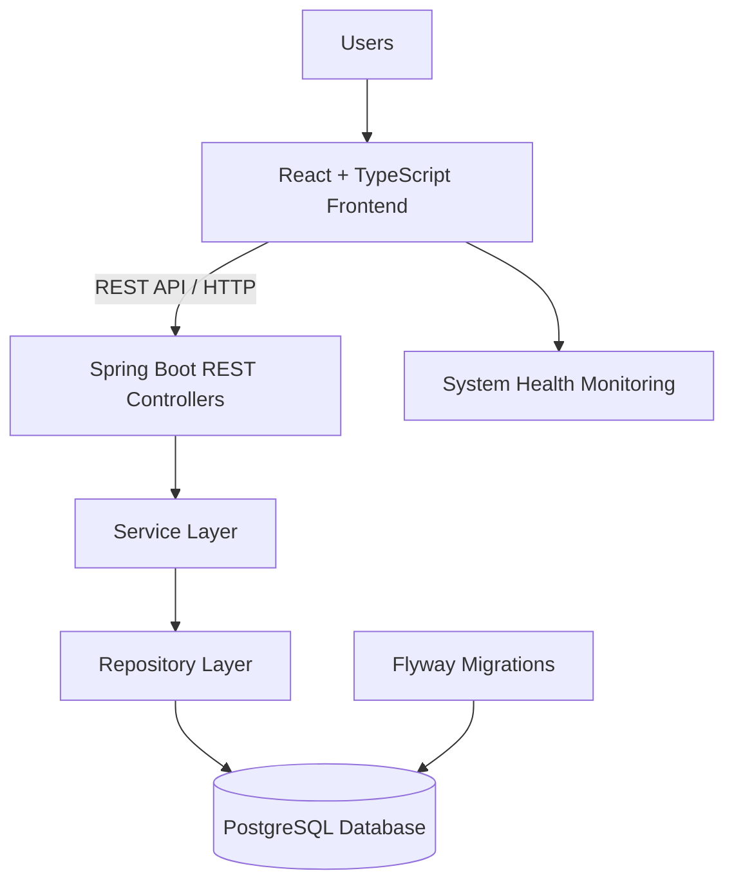
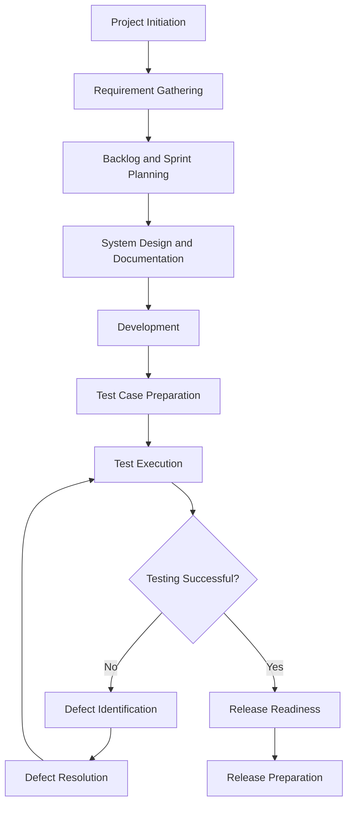
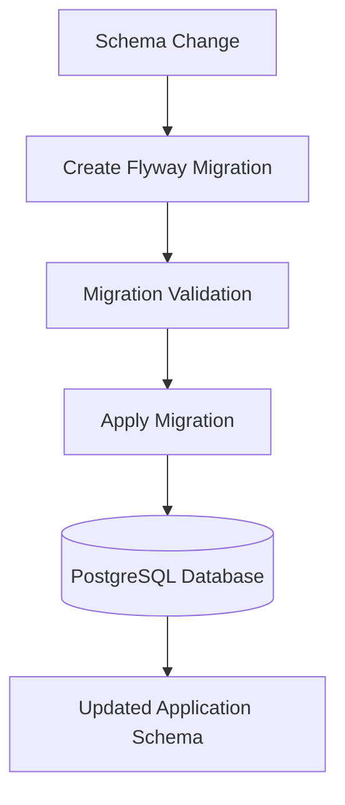
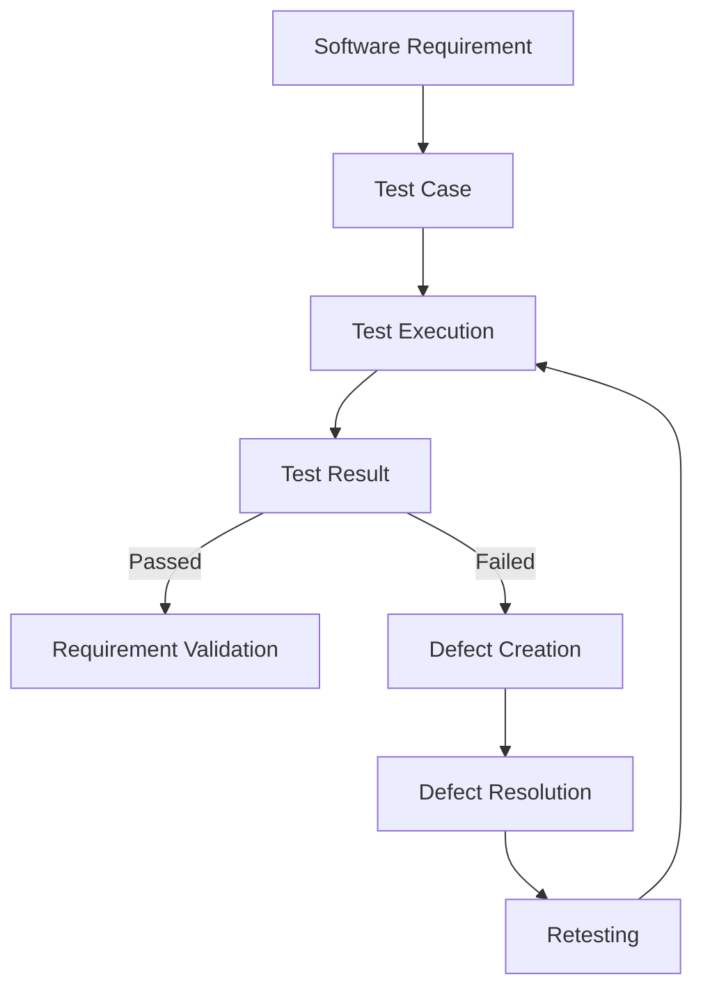

# Collaborative SDLC Management Platform

### A Unified Workspace for Software Project Planning, Development, Testing, and Delivery


---

## 🌟 Overview

The **Collaborative SDLC Management Platform** is a centralized web-based solution designed to manage the complete Software Development Life Cycle (SDLC) within a unified workspace.

Software development projects often rely on multiple disconnected tools for requirement gathering, project planning, technical documentation, development coordination, testing, and defect tracking. Managing these activities separately can result in fragmented information, communication gaps, and limited visibility into project progress.

This platform addresses these challenges by bringing essential software engineering activities together in one place.

It enables students, developers, team leaders, and reviewers to collaborate throughout the software development process, from initial requirements and sprint planning to quality assurance and release readiness.

The primary objective is to make software project management more structured, transparent, traceable, and efficient for both academic and professional teams.

---

## ✨ Key Features

### 🔐 1. Authentication and Access Management

* User registration and login.
* JWT-based authentication.
* Role-Based Access Control (RBAC).
* Protected application resources.
* Role-oriented access to platform functionality.

### 🏢 2. Organization and Team Management

* Organization management.
* Team creation and management.
* Team member allocation.
* Role-based team collaboration.
* Structured project participation.

### 📁 3. Project Management

* Create and manage software projects.
* Maintain project information and details.
* Organize project activities in a centralized workspace.
* Monitor project progress.
* Manage team participation and responsibilities.

### 📋 4. Requirements Management

* Create and manage software requirements.
* Organize requirements into user stories.
* Maintain requirement descriptions and priorities.
* Track requirements throughout the development lifecycle.
* Connect requirements with downstream testing activities.

### 🏃 5. Sprint and Backlog Management

* Organize development work into sprints.
* Maintain a structured project backlog.
* Plan and manage sprint activities.
* Assign work to team members.
* Monitor sprint progress and completion.

### 📐 6. Documentation and System Design

* Centralized project documentation.
* Product and requirements documentation.
* Architecture and design documentation.
* Diagram management using PlantUML.
* Technical documentation management.
* Architecture Decision Records (ADRs), where supported.

### 🔌 7. API Design Management

* Organize API design specifications.
* Maintain technical API documentation.
* Support structured API design workflows.
* Associate API documentation with project activities.

### 🧪 8. Testing and Quality Assurance

* Create and manage test suites.
* Organize test cases.
* Maintain test descriptions and expected outcomes.
* Execute test cases.
* Record execution results.
* Monitor testing progress.
* Maintain testing history.

### 🐛 9. Defect Tracking

* Report and manage software defects.
* Classify defects based on severity.
* Track defect status.
* Assign defects to team members.
* Link defects with relevant test cases.
* Monitor defect resolution.

### 🔗 10. Requirements-to-Test Traceability

* Connect requirements with test cases.
* Track test execution against requirements.
* Identify failed test cases.
* Associate defects with testing outcomes.
* Improve visibility across requirements and quality assurance.

### 🚀 11. Release Readiness

* Release readiness dashboard.
* Testing and quality status visibility.
* Defect status monitoring.
* Project readiness evaluation.
* Better visibility before release preparation.

### 🖥️ 12. System Health Monitoring

* Backend connectivity status.
* Application health monitoring.
* Database health information.
* System health visibility.
* Manual health status refresh.

---

## 🏗️ System Architecture

The platform follows a layered client-server architecture that separates the frontend, backend business logic, data access, and database responsibilities.

### Architecture Diagram



### Architecture Components

| Component      | Technology                | Responsibility                    |
| -------------- | ------------------------- | --------------------------------- |
| Frontend       | React, TypeScript         | User interface and interaction    |
| Build Tool     | Vite                      | Frontend development and bundling |
| Backend        | Java 17, Spring Boot      | Application logic and REST APIs   |
| API Layer      | REST                      | Frontend-backend communication    |
| Security       | JWT, RBAC                 | Authentication and authorization  |
| Service Layer  | Spring Boot               | Business logic and workflows      |
| Data Access    | Backend persistence layer | Database operations               |
| Database       | PostgreSQL 16             | Persistent data storage           |
| Migration      | Flyway                    | Database schema versioning        |
| Infrastructure | Docker Compose            | Local development environment     |

### Request Processing Flow

1. A user performs an action through the React frontend.
2. The frontend sends an HTTP request to the backend.
3. The Spring Boot controller receives the request.
4. The service layer processes the business logic.
5. The repository layer interacts with PostgreSQL.
6. The backend returns the appropriate response.
7. The frontend updates the interface.

---

## 🔄 Software Development Lifecycle Workflow

The platform is designed around the major stages of the Software Development Life Cycle.



This workflow provides a structured approach to managing development activities while maintaining visibility across the project lifecycle.

---

## 📁 Project Structure

The repository is organized into separate frontend and backend applications.

```text
SDLC_PROJECT/
│
├── .github/
│   └── workflows/
│
├── backend/
│   ├── src/
│   │   ├── main/
│   │   │   ├── java/
│   │   │   │   └── ...
│   │   │   └── resources/
│   │   │       ├── db/
│   │   │       │   └── migration/
│   │   │       └── application*.yml
│   │   │
│   │   └── test/
│   │
│   └── pom.xml
│
├── frontend/
│   ├── src/
│   ├── public/
│   ├── package.json
│   └── ...
│
├── docker-compose.yml
├── docker-compose.dev.yml
├── .env.example
├── .gitignore
├── README.md
├── start.bat
└── stop.bat
```

---

## 🗄️ Database Management

The platform uses **PostgreSQL** as its relational database.

### Database Management Approach

* PostgreSQL provides persistent storage for application data.
* Flyway manages database schema changes through version-controlled migration scripts.
* Migration scripts help maintain consistency across development environments.
* Database changes are applied in a structured and versioned manner.

### Database Migration Workflow



---

## 🔒 Security

The platform incorporates authentication and authorization mechanisms to protect application resources.

### Security Components

* JWT-based authentication.
* Role-Based Access Control.
* Protected backend endpoints.
* Server-side authorization checks.
* Environment-based configuration for sensitive values.

Security configuration and deployment practices should be reviewed before using the platform in a production environment.

---

## 🚀 Getting Started

The project includes startup and shutdown scripts to simplify the local development process on Windows.

### Prerequisites

Ensure the following software is installed:

* **Java Development Kit (JDK 17)**
* **Node.js and npm**
* **Docker Desktop**
* **Git**

### 1. Clone the Repository

```bash
git clone <YOUR_GITHUB_REPOSITORY_URL>
```

Navigate to the project directory:

```bash
cd SDLC_PROJECT
```

### 2. Configure Environment Variables

Create your local environment configuration:

```bash
copy .env.example .env
```

Update the required database credentials, JWT configuration, and other environment variables in `.env`.

**Important:** Never commit your actual `.env` file or expose passwords, credentials, or secret keys in the repository.

### 3. Start the Application (Recommended)

Make sure Docker Desktop is running.

From the root project directory, execute:

```bash
start.bat
```

The startup script provides a convenient way to launch the development environment.

It is the recommended startup method for Windows users.

### 4. Access the Application

Once the required services have started, access the application using the following addresses:

| Component | URL                   |
| --------- | --------------------- |
| Frontend  | http://localhost:5173 |
| Backend   | http://localhost:8081 |

### 5. Stop the Application

To stop the development environment, execute:

```bash
stop.bat
```

Run the script from the root project directory.

### Manual Startup

Alternatively, the services can be started individually.

**Start PostgreSQL:**

```bash
docker compose -f docker-compose.dev.yml up -d
```

**Start Backend:**

```bash
cd backend
mvn spring-boot:run
```

**Start Frontend:**

Open another terminal:

```bash
cd frontend
npm install
npm run dev
```

*Note: The exact startup and shutdown behavior is determined by the scripts and Docker Compose configuration included in the repository.*

---

## 🧪 Testing and Quality Assurance

Testing is an important part of the software development process.

The project includes testing at different application levels.

| Testing Type        | Purpose                                        |
| ------------------- | ---------------------------------------------- |
| Unit Testing        | Validate individual components and methods     |
| Integration Testing | Verify interactions between application layers |
| API Testing         | Validate backend endpoints and responses       |
| Functional Testing  | Verify application workflows                   |
| Frontend Testing    | Validate UI components and interactions        |
| Regression Testing  | Ensure existing functionality remains stable   |

### Platform Testing Capabilities

The platform also provides functionality to manage the testing process itself:

1. Create test suites.
2. Add and organize test cases.
3. Execute test cases.
4. Record execution results.
5. Identify failed test cases.
6. Create and track defects.
7. Monitor testing progress and release readiness.

### Running Tests

**Backend:**

```bash
cd backend
mvn test
```

**Frontend:**

```bash
cd frontend
npm test
```

*Use the test scripts defined in `frontend/package.json` if the frontend test command differs.*

---

## 🔗 Requirements Traceability

Requirements traceability maintains a connection between what a project needs to achieve and how those requirements are validated.

### Traceability Workflow



This approach helps teams identify untested requirements, monitor failed validations, and maintain better quality control.

---

## 📖 Application Workflow

A typical project workflow within the platform involves:

| Stage                    | Activity                                                       |
| ------------------------ | -------------------------------------------------------------- |
| 1. Project Creation      | Create a software project and maintain its basic information.  |
| 2. Team Organization     | Add team members and assign appropriate roles.                 |
| 3. Requirement Gathering | Document requirements and organize user stories.               |
| 4. Sprint Planning       | Create sprints and organize development activities.            |
| 5. System Design         | Maintain technical documentation and architecture diagrams.    |
| 6. Development           | Coordinate project activities and implementation work.         |
| 7. Testing               | Create test suites, define test cases, and execute tests.      |
| 8. Defect Management     | Record defects and monitor their resolution.                   |
| 9. Release Readiness     | Review testing progress, defect status, and project readiness. |

---

## 🔮 Future Enhancements

Potential areas for future development include:

* Real-time collaboration and notifications.
* Advanced project analytics and reporting.
* AI-assisted requirement analysis.
* Intelligent project blocker detection.
* Automated test case generation.
* Integration with GitHub repositories.
* Advanced sprint performance analytics.
* Automated release pipelines.
* Enhanced project health monitoring.

These are proposed enhancements and should not be interpreted as currently implemented functionality.

---

## 🤝 Contributing

Contributions and suggestions are welcome.

To contribute:

1. Fork the repository.
2. Create a feature branch.
3. Implement the required changes.
4. Run the relevant tests.
5. Commit using descriptive commit messages.
6. Submit a pull request describing your modifications.

### Commit Convention

Follow the Conventional Commits format:

```text
feat(scope): add new functionality
fix(scope): resolve an issue
test(scope): add or update tests
docs: update documentation
refactor(scope): improve code structure
chore(scope): update configuration
```

---

## 📌 Project Information

| Attribute          | Details                                |
| ------------------ | -------------------------------------- |
| Project Name       | Collaborative SDLC Management Platform |
| Domain             | Software Engineering                   |
| Application Type   | Web Application                        |
| Architecture       | Layered Client-Server Architecture     |
| Backend            | Java 17, Spring Boot                   |
| Frontend           | React, TypeScript, Vite                |
| Database           | PostgreSQL 16                          |
| Database Migration | Flyway                                 |
| Infrastructure     | Docker, Docker Compose                 |

---

## 👨‍💻 Acknowledgements

This project brings together concepts from software engineering, database management, web development, software testing, and collaborative project management.

It demonstrates how different stages of the Software Development Life Cycle can be organized and managed through a centralized platform.

---

<div align="center">

### Collaborative SDLC Management Platform

**Bringing the entire software development lifecycle into one workspace.**

</div>
